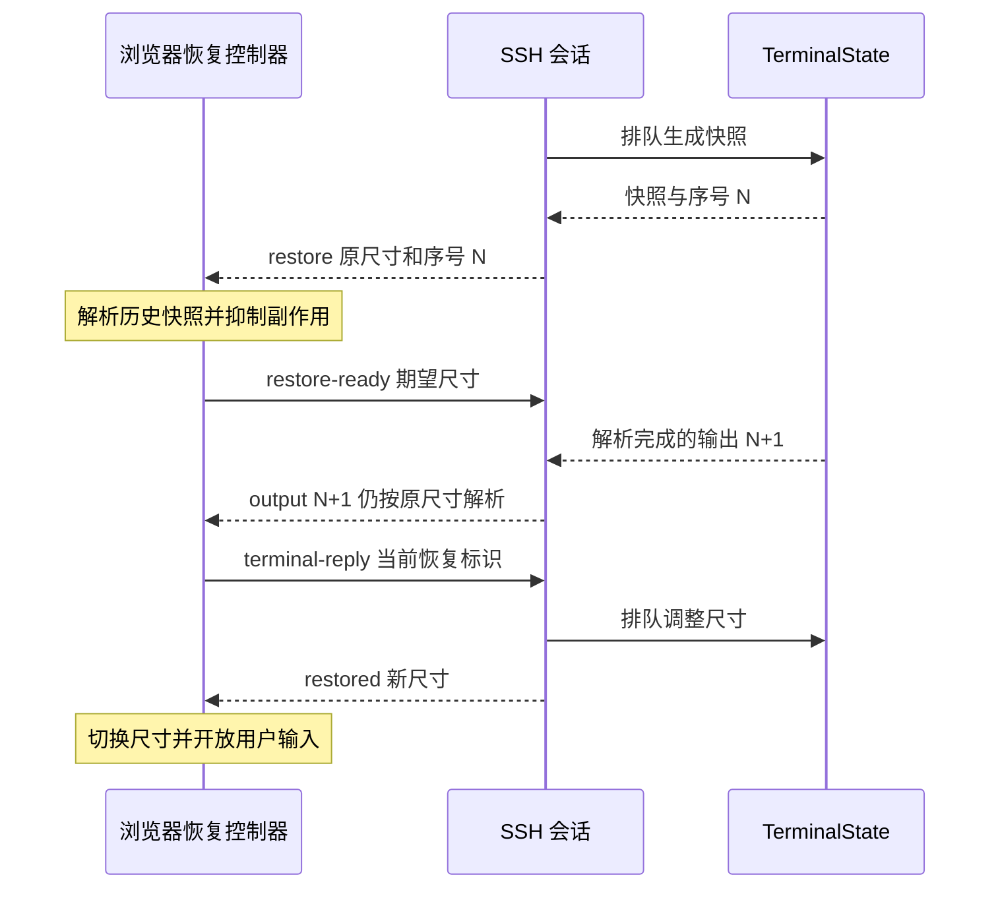

# 终端会话恢复架构优化方案

目标是让恢复协议、组件职责和资源边界直接体现在代码中。保留单进程 SSH 会话、headless xterm 状态镜像以及有序快照恢复，不引入新的服务或状态框架。基线提交为 `bcac373`。

## 组件与状态归属

| 组件 | 拥有的职责 | 不应承担的职责 |
| --- | --- | --- |
| 共享终端协议 | 双向消息、快照结构、传输上限 | 加密、SSH、React 状态 |
| TerminalState | 终端解析、快照、输出序号、操作顺序 | 连接恢复阶段、网络发送策略 |
| 会话注册表 | 会话索引、目标策略、运行设置注入 | 单个 SSH 会话内部状态 |
| ManagedTerminalSession | SSH 生命周期、当前连接身份、恢复阶段、TTL | 运行配置读取、WebSocket 缓冲、加解密 |
| WebSocket 网关 | 认证、消息校验、加密封包、发送积压限制 | 终端解析、快照拼接 |
| 浏览器安全传输 | 有界且有序的收发、加解密、心跳、关闭时排空 | xterm、恢复阶段、React |
| 浏览器恢复控制器 | 快照解析、增量顺序、尺寸屏障、输入权限 | WebSocket、React、DOM 生命周期 |
| useTerminalSession | 创建和释放终端、组装控制器与传输、绑定界面状态 | 加密队列、恢复消息状态机 |

服务端 SSH 生命周期为 `open → ending → closed`，连接独立经历 `snapshotting → awaiting-ready → resizing → interactive`，断开后移除连接对象。每次接管创建独立连接身份；所有输入、回复和异步尺寸操作都验证当前连接。

## 协议和副作用

1. 服务端在终端操作队列内发送快照，随后发送带独立序号的实时增量。
2. 浏览器在原始尺寸解析快照，完成后发送 `restore-ready` 与期望尺寸。
3. 服务端排队调整尺寸并返回 `restored`，浏览器随后开放用户输入。
4. 历史快照解析期间禁用终端回复与剪贴板副作用；实时增量的终端回复使用独立消息，带当前恢复标识，可在等待确认期间发送。
5. 恢复控制器区分快照写入、实时写入和用户输入。恢复期间阻止键盘、工具栏粘贴与快捷键，避免它们进入回复通道。
6. 后端 headless xterm 保持被动镜像，避免向 SSH 重复回复。

## 资源与失败语义

- 终端解析队列超限属于会话处理失败，关闭 SSH 会话，保留现有语义。
- WebSocket 发送积压、浏览器收发队列超限属于连接消费失败，仅断开浏览器，SSH 保留到恢复 TTL。
- 收发队列同时限制字节数和任务数；发送检查包含加密及 JSON 后的帧大小。
- 浏览器正常关闭时排空已接收消息，异常或卸载时取消后续处理，不截断仍在使用的终端生命周期。
- 不丢弃终端中间输出；序号断裂关闭连接并要求重新恢复。
- 输入超限明确失败，不静默裁剪命令。

传输准入上限为每方向 16 MiB 或 2048 条待处理消息，包含运行中的任务；WebSocket 发送另检查加密后的帧与发送缓冲总字节数，服务端同时限制未完成的发送数。浏览器输入缓冲上限为 64 Ki 字符。超限后停止当前连接后续任务，不绕过序号检查继续消费。

## 构建边界

共享契约位于仓库根目录 `shared`，不依赖前端或后端实现。后端编译根目录扩展为仓库根，输出目录改为 `dist`，保持入口 `dist/backend/server.js`，同时产出 `dist/shared`。前端直接编译共享源码；生产依赖追踪负责将后端使用的共享运行模块纳入文件包。

## 实施顺序

1. 统一双向协议，显式表达服务端恢复阶段和连接身份。
2. 提取浏览器恢复控制器，修复实时协议回复的恢复窗口，封装鼠标编码兼容。
3. 提取有界安全传输，补齐后端 WebSocket 发送限制和关闭策略。
4. 精简 Hook，补核心状态机、故障路径和浏览器回归验证，更新架构说明。

OutputFramer 只确定控制序列分帧边界，终端解释继续交给 xterm。保留分块控制序列测试，增加多种分块边界的一致性验证；不扩展为通用 VT 解释器。

## 验收标准

- Hook 不再拥有加解密收发队列或恢复阶段处理逻辑，只转交终端状态消息。
- 前后端使用同一份消息类型；服务端没有多个恢复布尔值组合。
- 快照期间副作用受抑制，实时查询在恢复完成前仍能回复，用户输入仍被阻止。
- 旧连接无法输入、调整尺寸或确认新连接恢复；超时不会关闭仍可恢复的 SSH。
- 输出积压明确失败且不丢弃中间输出；正常关闭保留最终输出。
- 核心逻辑测试、类型检查、生产构建和真实 SSH 浏览器回归通过。
- 验证在独立临时副本进行，不使用当前仓库依赖，不影响运行中的真机服务。

## 执行记录

- 已提交当前快照恢复与鼠标滚动修复，开始本方案实施。
- 已完成共享协议、显式恢复阶段、连接身份校验和独立实时回复消息。
- 已拆分会话注册表与单个会话，单个会话通过构造参数接收设置与 SSH 连接工厂。
- 已提取浏览器恢复控制器与有界安全传输，Hook 负责组装、DOM 生命周期和界面状态。
- 已封装鼠标编码兼容查询，并补充控制序列不同分块边界的一致性验证。
- 核心测试 28 项通过；真实 SSH 浏览器回归 17 项通过，包含人为延迟恢复确认的查询回复验证，以及超限粘贴后的原会话恢复。
- 最终类型检查、前后端生产构建和核心测试通过；生产文件包生成成功，并通过包内终端快照与共享协议模块加载检查。
- 验证副本为 `/private/tmp/webterminal-architecture.ZClDEq`；核心测试、类型检查、构建、浏览器回归和包验证日志均保留在该目录。
